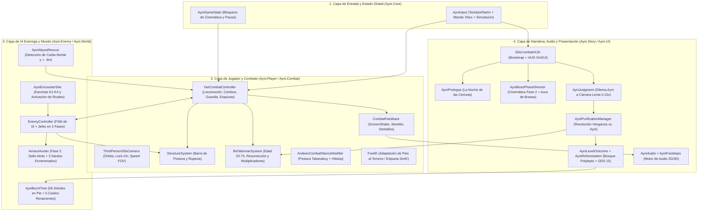
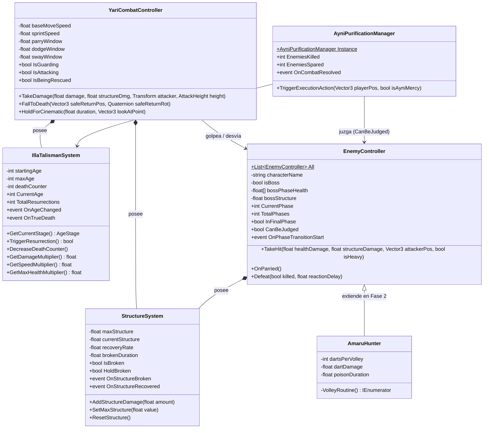
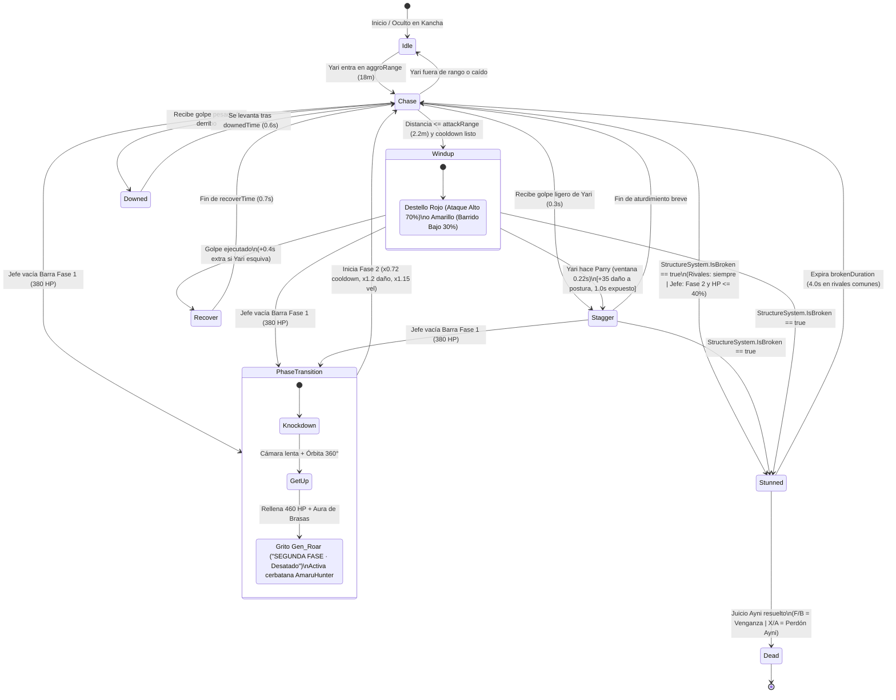
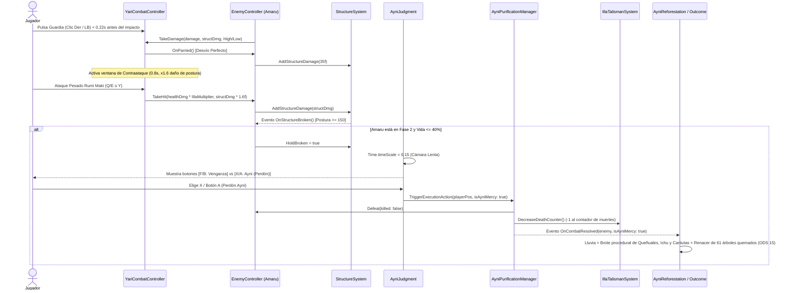

# 🏗️ ARQUITECTURA TÉCNICA Y DE SOFTWARE
# 🌄 AYNI: EL RETORNO DEL GUARDIÁN (`v0.7.0`)

> **Documento de Ingeniería de Software y Arquitectura de Sistemas**  
> **Motor:** Unity 6 (`6000.3.23f1`) · **Pipeline Gráfico:** Universal Render Pipeline (URP `17.3.0`) · **Lenguajes:** C# 9.0, HLSL (ShaderLab), Python 3

---

## 📌 1. VISIÓN GENERAL DE LA ARQUITECTURA

**AYNI: El Retorno del Guardián** implementa una arquitectura modular desacoplada basada en **Componentes orientados a Eventos (Event-Driven Component Architecture)** y **Máquinas de Estados Finitos (FSM)** bajo el espacio de nombres raíz `Ayni.*`.

### Principios de Diseño Aplicados
1. **Auto-Ensamblaje en Tiempo de Ejecución (*Runtime Bootstrap Pattern*):** Para evitar conflictos de fusión (*merge conflicts*) sobre el archivo binario/YAML de la escena principal (`Assets/network of paths/Scenes/SampleScene.unity`), el componente [`SifuCombatHUD`](Assets/Scripts/UI/SifuCombatHUD.cs) actúa como inyector de dependencias en `Start()`, instanciando dinámicamente los directores de historia, audio, menú de pausa, juicio moral y comportamientos de segunda fase de jefes.
2. **Desacoplamiento por Eventos (`System.Action`):** Los sistemas troncales ([`StructureSystem`](Assets/Scripts/Combat/StructureSystem.cs), [`IllaTalismanSystem`](Assets/Scripts/Core/IllaTalismanSystem.cs), [`AyniPurificationManager`](Assets/Scripts/Core/AyniPurificationManager.cs) y [`AyniEncounterSite`](Assets/Scripts/World/AyniEncounterSite.cs)) publican eventos C# puros sin depender directamente de la capa de interfaz ni de la narrativa.
3. **Generación Procedural de Activos (*Code-Driven Content*):** Tanto las animaciones de esquiva/caída ([`AyniAnimationForge`](Assets/Editor/AyniAnimationForge.cs)), como la aldea inca ([`AyniVillageBuilder`](Assets/Editor/AyniVillageBuilder.cs)), el bosque de queñuales ([`AyniReforestation`](Assets/Scripts/Story/AyniReforestation.cs)) y los 42 efectos de sonido ([`generar_sfx.py`](Herramientas/Audio/generar_sfx.py)) se construyen por código reproducible.

---

## 🧩 2. DIAGRAMA DE ARQUITECTURA EN CAPAS

---

## 📦 3. ORGANIZACIÓN DE MÓDULOS Y SCRIPTS DE RUNTIME (`Assets/Scripts/`)

El código de tiempo de ejecución consta de **29 scripts C#** distribuidos en **7 espacios de nombres**:

### 3.1. Módulo `Ayni.Core` (Sistemas Nucleares)
| Script | Responsabilidad Principal |
| :--- | :--- |
| [`AyniInput.cs`](Assets/Scripts/Core/AyniInput.cs) | Capa de abstracción de entrada que unifica Teclado/Ratón y Mando de Xbox (ejes `Ayni_*`), detecta en tiempo real el dispositivo activo (`UsingGamepad`) para actualizar las etiquetas del HUD/Tutorial y permite inyección de entradas simuladas (`Simulate`, `SimulateMove`, `SimulateKeys`). |
| [`IllaTalismanSystem.cs`](Assets/Scripts/Core/IllaTalismanSystem.cs) | Gestiona la edad de Yari (`startingAge = 20`, `maxAge = 75`), el contador de muertes (`deathCounter`) y las tres etapas vitales (`Youth`, `Prime`, `Elder`), calculando los multiplicadores de daño, velocidad y vida máxima. |
| [`AyniPurificationManager.cs`](Assets/Scripts/Core/AyniPurificationManager.cs) | Singleton que evalúa el dilema moral sobre enemigos con estructura rota (`TriggerExecutionAction`): **Venganza** (`killed: true`) o **Perdón Ayni** (`killed: false`, que invoca `DecreaseDeathCounter()` en el talismán). |
| [`AyniAudio.cs`](Assets/Scripts/Core/AyniAudio.cs) | Motor de sonido sin dependencias externas; carga bajo demanda los 42 clips `.wav` desde `Resources/AyniAudio/`, aplica variación aleatoria de tono/clip, espacialización 3D y mezcla de bucles ambientales. |
| [`AyniFootsteps.cs`](Assets/Scripts/Core/AyniFootsteps.cs) | Emite sonidos de pasos sobre piedra sincronizados con la distancia física de cada zancada recorrida en el suelo. |
| [`AyniGameState.cs`](Assets/Scripts/Core/AyniGameState.cs) | Estado global de bloqueo de entrada durante cinemáticas (`CinematicPlaying`, `InputLocked`). |
| [`AyniVersion.cs`](Assets/Scripts/Core/AyniVersion.cs) | Constante central de versionado semántico (`v0.7.0`) mostrada en el HUD y herramientas del editor. |

### 3.2. Módulo `Ayni.Player` (Control del Jugador y Cámara)
| Script | Responsabilidad Principal |
| :--- | :--- |
| [`YariCombatController.cs`](Assets/Scripts/Player/YariCombatController.cs) | Controlador principal de Yari (2,119 líneas). Implementa locomoción de 3 marchas con corrección dinámica de cadencia para eliminar el patinaje de pies, salto en carrera (`Run_Jump`), guardia plantada, 3 esquivas en el sitio (`Avoid_Duck`, `Avoid_Jump`, `Avoid_SwayL/R`), ventana de *Parry* (`0.22s`), contraataque (`+60%` daño de postura), combos ligeros/pesados con *input buffer* (`0.30s`), selección direccional de rival con stick y patada hacia atrás (`Atk_BackKick`). |
| [`ThirdPersonSifuCamera.cs`](Assets/Scripts/Player/ThirdPersonSifuCamera.cs) | Cámara cinemática en tercera persona sobre el hombro con prevención de colisiones mediante `SphereCast`, encuadre compartido en modo *Lock-On* y apertura dinámica de FOV (`+4°` al correr, `+10°` en sprint). |

### 3.3. Módulo `Ayni.Combat` (Física Marcial y Postura)
| Script | Responsabilidad Principal |
| :--- | :--- |
| [`StructureSystem.cs`](Assets/Scripts/Combat/StructureSystem.cs) | Gestiona la barra de Estructura/Postura (`100` en rivales comunes, `150` en jefes). Tras `1.2s` sin recibir golpes se recupera a `18 pts/s`. Al saturarse activa `IsBroken` durante `4.0s` (o indefinidamente si `HoldBroken = true` durante el Juicio Ayni). |
| [`AndeanCombatStanceModifier.cs`](Assets/Scripts/Combat/AndeanCombatStanceModifier.cs) | Modificador procedural en `LateUpdate` sobre el rig Humanoid que aplica la postura tradicional **Takanakuy / Rumi Maki** (descenso de cadera `-12 cm`, inclinación de torso `8°`, apertura de codos `14°`) y micro-pausas de impacto (*Hitstop* de `0.065s`). |
| [`FootIK.cs`](Assets/Scripts/Combat/FootIK.cs) | Cinemática inversa de pies para adaptar el apoyo de Yari a pendientes y peldaños de los andenes. Se inhibe automáticamente cuando el estado del Animator contiene la etiqueta `SinIK`. |
| [`AttackTimingTable.cs`](Assets/Scripts/Combat/AttackTimingTable.cs) | `ScriptableObject` (`YariAttackTimings.asset`) que almacena el segundo exacto de impacto de cada animación de combate y la velocidad base en `m/s` de cada clip de locomoción. |
| [`CombatFeedback.cs`](Assets/Scripts/Combat/CombatFeedback.cs) | Coordina el *Game Feel*: sacudida de cámara (*Screen Shake*), cámara lenta breve al esquivar/romper postura y disparo de sonidos de golpe. |
| [`CombatTypes.cs`](Assets/Scripts/Combat/CombatTypes.cs) | Enumeraciones compartidas (`AttackHeight.High`, `AttackHeight.Low`) para lectura de esquivas. |
| [`RootMotionRelay.cs`](Assets/Scripts/Combat/RootMotionRelay.cs) | Reenvía el desplazamiento `OnAnimatorMove` del sub-objeto del modelo 3D hacia el controlador raíz. |

### 3.4. Módulo `Ayni.Enemy` (Inteligencia Artificial y Jefes)
| Script | Responsabilidad Principal |
| :--- | :--- |
| [`EnemyController.cs`](Assets/Scripts/Enemy/EnemyController.cs) | Máquina de estados de IA (`Idle`, `Chase`, `Windup`, `Recover`, `Stagger`, `Stunned`, `Downed`, `Dead`), telégrafos cromáticos (rojo = golpe alto, amarillo = barrido bajo), sistema de jefes multifase (`bossPhaseHealth = { 380f, 460f }`) con rutina de transición invulnerable (`PhaseTransitionRoutine`) y apertura del Juicio Ayni en la fase final (`≤ 40%` HP). |
| [`AmaruHunter.cs`](Assets/Scripts/Enemy/AmaruHunter.cs) | Comportamiento especializado de la Fase 2 de **Amaru el Cazador**: salto acrobático de `5.5 m` hacia atrás y disparo de ráfagas de 3 dardos envenenados con aviso verde (`0.5s`), esquivables, bloqueables o desviables con *Parry*. |

### 3.5. Módulo `Ayni.Story` (Dirección Cinemática y Reforestación)
| Script | Responsabilidad Principal |
| :--- | :--- |
| [`AyniPrologue.cs`](Assets/Scripts/Story/AyniPrologue.cs) | Secuencia cinemática-jugable *"La Noche de las Cenizas"* en el puente colgante (~43 s, omitible con `Tab`/`Esc`/`Menu`). |
| [`AyniBossPhaseDirector.cs`](Assets/Scripts/Story/AyniBossPhaseDirector.cs) | Dirige la cinemática de transición entre la Fase 1 y Fase 2 de Amaru: caída en cámara lenta, órbita de cámara de 360°, rugido `Gen_Roar`, título *"SEGUNDA FASE · Desatado"* y generación del aura de brasas (`AyniEnrageAura`). |
| [`AyniJudgment.cs`](Assets/Scripts/Story/AyniJudgment.cs) | Ralentiza el tiempo a `0.15x` cuando la postura del jefe se rompe en su última fase y presenta la interfaz de decisión moral (**Venganza** vs. **Ayni**). |
| [`AyniLevelOutcome.cs`](Assets/Scripts/Story/AyniLevelOutcome.cs) | Ejecuta la cinemática de cierre del Nivel 1 según la decisión tomada, presenta el mensaje del **ODS 15** y despliega la tarjeta de estadísticas finales. |
| [`AyniReforestation.cs`](Assets/Scripts/Story/AyniReforestation.cs) | Genera proceduralmente en tiempo de ejecución mallas y texturas de un bosque de **queñuales (`Polylepis`)**, matas de **ichu** y flores de **cantuta** que emergen en ola concéntrica al perdonar a Amaru. |
| [`AyniReforestationRevival.cs`](Assets/Scripts/Story/AyniReforestationRevival.cs) | Extiende la ola de vida a lo largo de los 630 m del Qhapaq Ñan para hacer reverdecer los 56 árboles quemados en pie y 5 caídos. |
| [`AyniLevelAmbience.cs`](Assets/Scripts/Story/AyniLevelAmbience.cs) | Controla el sonido ambiental de viento andino y activa tambores rituales al entrar en las kanchas con rivales. |

### 3.6. Módulos `Ayni.World` y `Ayni.UI`
| Script | Responsabilidad Principal |
| :--- | :--- |
| [`AyniEncounterSite.cs`](Assets/Scripts/World/AyniEncounterSite.cs) | Gestiona cada una de las 4 kanchas incas (`K1` a `K4`), manteniendo ocultos a sus rivales hasta que Yari cruza el umbral (`triggerRadius`) y emitiendo `OnCleared` al derrotarlos. |
| [`AyniAbyssRescue.cs`](Assets/Scripts/World/AyniAbyssRescue.cs) | Registra la última posición segura de Yari en el camino (`y >= 0.5m`, pendiente `< 30°`). Si cae a la garganta (`y < -3m`), dispara `FallToDeath` y lo resucita mediante el Talismán Illa. |
| [`AyniBurntTree.cs`](Assets/Scripts/World/AyniBurntTree.cs) | Almacena la geometría y puntos de rebrote de cada árbol quemado del camino para su restauración en el final Ayni. |
| [`SifuCombatHUD.cs`](Assets/Scripts/UI/SifuCombatHUD.cs) | Dibuja el HUD táctico (barras de vida/postura, edad, avisos de ataque y marcadores de rotura) e inicializa los sistemas del nivel. |
| [`AyniPauseMenu.cs`](Assets/Scripts/UI/AyniPauseMenu.cs) | Menú de pausa (`Esc` / `Menu`) con control persistente de volúmenes (`PlayerPrefs`), consulta del tutorial y reinicio del nivel. |
| [`AyniTutorial.cs`](Assets/Scripts/UI/AyniTutorial.cs) | Tutorial paginado de 4 pantallas adaptado dinámicamente a Teclado/Ratón o Mando de Xbox. |
| [`AyniScreenFX.cs`](Assets/Scripts/UI/AyniScreenFX.cs) | Fundidos a negro, franjas cinematográficas (*letterbox*), subtítulos, carteles de título y viñeta verde de envenenamiento. |
| [`AyniGamepadTester.cs`](Assets/Scripts/UI/AyniGamepadTester.cs) | Depurador superpuesto en vivo (`F9`) para inspeccionar ejes y botones del mando conectado. |

---

## 📐 4. DIAGRAMAS UML Y DE COMPORTAMIENTO (MERMAID)

### 4.1. Diagrama de Clases Principal (`classDiagram`)

---

### 4.2. Máquina de Estados de la IA Enemiga y Fases de Jefe (`stateDiagram-v2`)

---

### 4.3. Diagrama de Secuencia: Combate, Parry, Juicio Ayni y Reforestación (`sequenceDiagram`)

---

## 🦿 5. SUBSISTEMA DE ANIMACIÓN PROCEDURAL Y CALIBRACIÓN ANTI-PATINAJE

Uno de los desafíos técnicos más importantes resueltos en la arquitectura del juego es la coexistencia entre animaciones capturadas de **Mixamo**, animaciones sintetizadas por código en **la Fragua** y modificadores esqueléticos en tiempo real:

1. **Horneado de Tiempos y Velocidades ([`AyniAttackTimingBaker.cs`](Assets/Editor/AyniAttackTimingBaker.cs)):**
   - Al construir el `AnimatorController`, el editor simula cada clip de locomoción sobre el esqueleto de Yari, mide cuántos metros por segundo cubre cada zancada y serializa los datos en `Assets/Resources/YariAttackTimings.asset`.
   - En tiempo de ejecución, [`YariCombatController`](Assets/Scripts/Player/YariCombatController.cs) ajusta `animator.speed = velocidadReal / velocidadBaseDelClip` dentro de topes seguros (`maxRunCadence = 1.05x`, `maxSprintCadence = 1.3x`), reduciendo el patinaje de pies de ~94% a un rango imperceptible de **1% a 9%**.
2. **La Fragua de Animaciones ([`AyniAnimationForge.cs`](Assets/Editor/AyniAnimationForge.cs)):**
   - Sintetiza 9 clips `.anim` en `Assets/Art/Characters/Animations/Generadas/` (`Yari_Avoid_Duck`, `Yari_Avoid_Jump`, `Yari_Avoid_SwayL/R`, `Yari_Back_Kick`, `Yari_Fall_Loop`, `Yari_Fall_Back`, `Yari_Land_Hard`, `Gen_Roar`) manipulando curvas de músculos del `HumanPoseHandler`.
3. **Aislamiento con Etiqueta `SinIK`:**
   - Como los clips generados por código no incluyen pistas de metas de IK de pies (*Foot IK goals*), aplicar [`FootIK`](Assets/Scripts/Combat/FootIK.cs) o [`AndeanCombatStanceModifier`](Assets/Scripts/Combat/AndeanCombatStanceModifier.cs) sobre ellos colapsaría las piernas hacia el origen del hueso.
   - [`AyniAnimatorUpgrade`](Assets/Editor/AyniAnimatorUpgrade.cs) etiqueta todos los estados generados con el tag `SinIK`, de modo que tanto `FootIK` como `AndeanCombatStanceModifier` ceden el control limpiamente durante esquivas, caídas y patadas traseras.

---

## 🎨 6. PIPELINE DE SHADERS URP A MEDIDA (`Assets/Shaders/`)

El entorno andino prescinde de materiales externos pesados utilizando **5 Shaders HLSL para Universal Render Pipeline**:

| Shader | Técnica Gráfica Implementada |
| :--- | :--- |
| [`AyniTerrenoAndino.shader`](Assets/Shaders/AyniTerrenoAndino.shader) | Mapeo **Triplanar** sin estiramiento en los acantilados verticales de la garganta (`y = -18m`), dibujo procedural de losas del *Qhapaq Ñan* y mampostería en los taludes de los andenes agrícolas mediante máscara de control (`Ayni_Control.png`). |
| [`AyniMuroInca.shader`](Assets/Shaders/AyniMuroInca.shader) | Genera mampostería incaica 100% en el *Fragment Shader* usando coordenadas UV en metros reales: modo **0 = Pirca rústica** (piedra irregular con mortero de barro), **1 = Sillería imperial** (bloques poligonales almohadillados en hiladas) y **2 = Piedra monolítica** (dinteles y jambas trapezoidales). |
| [`AyniAguaQuebrada.shader`](Assets/Shaders/AyniAguaQuebrada.shader) | Superficie de río de montaña con desplazamiento de ondas normales, espuma en las orillas y reflejo cálido de Hora Dorada. |
| [`AyniNiebla.shader`](Assets/Shaders/AyniNiebla.shader) | Planos de niebla volumétrica suave para el fondo del cañón con desvanecimiento por profundidad. |
| [`AyniMontanasLejanas.shader`](Assets/Shaders/AyniMontanasLejanas.shader) | Siluetas perimetrales de la cordillera de los Andes con nieve en las cumbres según altitud y perspectiva atmosférica. |

---

## 🛠️ 7. AUTOMATIZACIÓN DE EDITOR Y PUENTE DE AGENTES (`Assets/Editor/`)

El directorio `Assets/Editor/` contiene **28 herramientas de automatización** que permiten reconstruir el nivel, auditar el rendimiento y ejecutar pruebas sin intervención manual:

- **Construcción del Mundo:** [`AyniEnvironmentBuilder.cs`](Assets/Editor/AyniEnvironmentBuilder.cs), [`AyniAtmosphere.cs`](Assets/Editor/AyniAtmosphere.cs), [`AyniVillageBuilder.cs`](Assets/Editor/AyniVillageBuilder.cs), [`AyniVillageGeometry.cs`](Assets/Editor/AyniVillageGeometry.cs), [`AyniVillageObstacles.cs`](Assets/Editor/AyniVillageObstacles.cs) y [`AyniRivalSetup.cs`](Assets/Editor/AyniRivalSetup.cs).
- **Puente Asíncrono para Agentes ([`AyniAgentBridge.cs`](Assets/Editor/AyniAgentBridge.cs)):** Escucha comandos en `UserSettings/AyniAgent/cmd.txt` (`refresh`, `play`, `stop`, `wait`, `call`, `capture`, `screenshot`) y vuelca el estado y errores de compilación en `log.txt`.
- **Sondas de Verificación ([`AyniPlaytestProbe.cs`](Assets/Editor/AyniPlaytestProbe.cs) y [`AyniLocomotionProbe.cs`](Assets/Editor/AyniLocomotionProbe.cs)):** Permiten teletransportar a Yari, medir el porcentaje exacto de patinaje de pies en tiempo real, simular combates contra jefes y grabar secuencias de fotogramas.
- **Producción y Despliegue:** [`AyniTrailerRunner.cs`](Assets/Editor/AyniTrailerRunner.cs) (grabación automatizada en 1080p a 30 fps) y [`AyniWebBuild.cs`](Assets/Editor/AyniWebBuild.cs) (compilación optimizada WebGL con reducción de texturas a 1024/2048 px y compresión Gzip para **Unity Play**).

---
*Documento de Arquitectura de Software — Proyecto Ayni: El Retorno del Guardián.*
