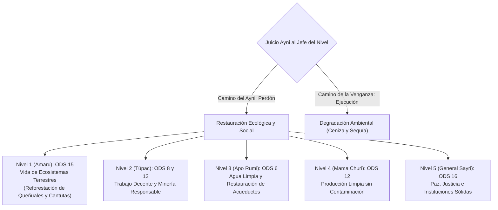
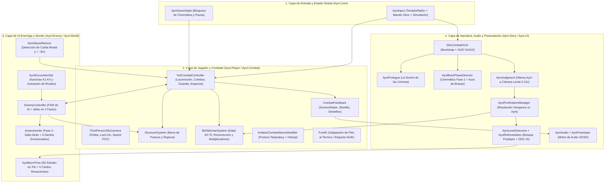
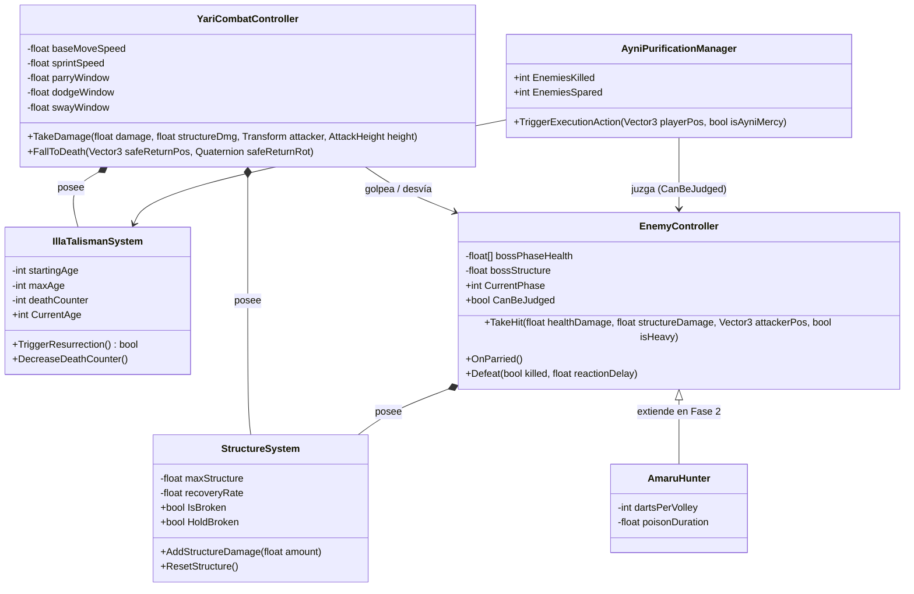
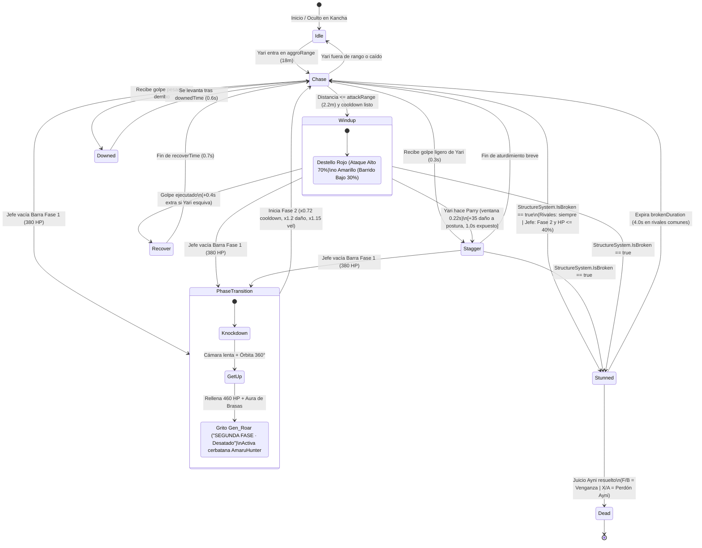
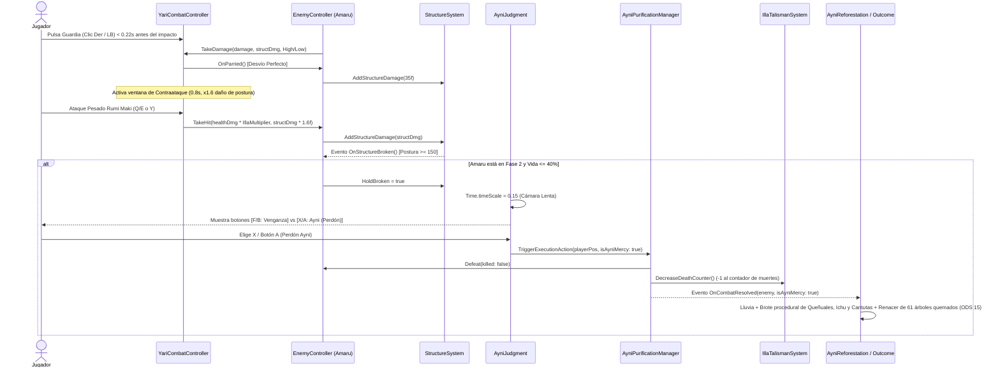

# 📘 DOCUMENTACIÓN INTEGRAL DEL PROYECTO DE VIDEOJUEGO
# 🌄 AYNI: EL RETORNO DEL GUARDIÁN (`v0.7.0`)

> **Curso:** Desarrollo de Videojuegos — Ingeniería de Sistemas  
> **Motor de Desarrollo:** Unity 6 (`6000.3.23f1`) · **Pipeline Gráfico:** Universal Render Pipeline (URP `17.3.0`)  
> **Repositorio Oficial:** [https://github.com/Brayan09r/Ayni-El-Retorno-del-Guardian](https://github.com/Brayan09r/Ayni-El-Retorno-del-Guardian)  
> **Versión Web Jugable (Unity Play):** [https://play.unity.com/en/games/66b8abca-71ca-4703-8580-d51948d2be29/ayninivel1](https://play.unity.com/en/games/66b8abca-71ca-4703-8580-d51948d2be29/ayninivel1)

---

## 📑 ÍNDICE GENERAL DE LA DOCUMENTACIÓN

1. [Resumen Ejecutivo y Ficha Técnica del Proyecto](#1-resumen-ejecutivo-y-ficha-técnica-del-proyecto)
2. [Historia, Narrativa y Fundamentación Cultural Andina](#2-historia-narrativa-y-fundamentación-cultural-andina)
3. [Diseño de Juego (GDD) y Mecánicas de Combate](#3-diseño-de-juego-gdd-y-mecánicas-de-combate)
4. [Arquitectura Técnica, Diagramas UML/Mermaid y Software](#4-arquitectura-técnica-diagramas-umlmermaid-y-software)
5. [Diseño del Nivel 1, Aldea Inca, Rivales y Proyección de Niveles 2–5](#5-diseño-del-nivel-1-aldea-inca-rivales-y-proyección-de-niveles-25)
6. [Plan de Pruebas de Calidad (QA), Métricas y Catálogo de Recursos](#6-plan-de-pruebas-de-calidad-qa-métricas-y-catálogo-de-recursos)

> **Documentos Especializados por Módulo en el Repositorio:**
> - 🏗️ [Arquitectura Técnica y Diagramas UML/Mermaid (`ARQUITECTURA_TECNICA.md`)](ARQUITECTURA_TECNICA.md)
> - 🧪 [Plan de Pruebas QA y Matrices de Balanceo (`PLAN_DE_PRUEBAS_QA.md`)](PLAN_DE_PRUEBAS_QA.md)
> - 🏔️ [Narrativa, Glosario Quechua y Enfoque ODS (`NARRATIVA_Y_CULTURA_ANDINA.md`)](NARRATIVA_Y_CULTURA_ANDINA.md)
> - 🗺️ [Diseño de Niveles 2 al 5 (`DISENO_NIVELES_2_AL_5.md`)](DISENO_NIVELES_2_AL_5.md) y [Prompts 3D de Jefes (`ConceptArt/Jefes_y_Prologo/prompts.md`)](ConceptArt/Jefes_y_Prologo/prompts.md)
> - 📦 [Catálogo de Recursos Multimedia y Licencias (`CATALOGO_RECURSOS_Y_LICENCIAS.md`)](CATALOGO_RECURSOS_Y_LICENCIAS.md)

---

## 1. RESUMEN EJECUTIVO Y FICHA TÉCNICA DEL PROYECTO

**AYNI: El Retorno del Guardián** es un videojuego tridimensional de acción táctica y artes marciales en tercera persona (género *Beat 'em up* táctico), inspirado en referentes contemporáneos como *Sifu* y *Sekiro: Shadows Die Twice*, ambientado en un universo andino mítico durante la época del Tawantinsuyu. El proyecto integra mecánicas avanzadas de combate cuerpo a cuerpo basadas en el arte marcial ancestral del **Rumi Maki** (*Puño de Piedra* / *Takanakuy*) con una profunda reflexión ética y ecológica fundamentada en el principio de reciprocidad andina (**Ayni**) y los **Objetivos de Desarrollo Sostenible (ODS)**.

| Parámetro Técnico | Especificación del Proyecto |
| :--- | :--- |
| **Título Oficial** | AYNI: El Retorno del Guardián |
| **Versión Actual** | `v0.7.0` (Jefes en dos fases, menú de pausa persistente y balanceo de combate) |
| **Género y Perspectiva** | 3D Martial Arts Beat 'em up / Acción Táctica en Tercera Persona sobre el hombro (*Over-The-Shoulder*) |
| **Motor Gráfico y Pipeline** | Unity 6 (`6000.3.23f1`) con Universal Render Pipeline (`URP 17.3.0`) |
| **Lenguajes de Programación** | C# (`87.7%` — Lógica y Editor), Python 3 (`4.8%` — Síntesis de audio y video), ShaderLab/HLSL (`3.3%` — Shaders URP) |
| **Plataformas Soportadas** | PC (Windows / Linux / macOS) y Navegador Web (WebGL publicado en Unity Play) |
| **Dispositivos de Entrada** | Teclado y Ratón / Mando de Xbox (detección automática en tiempo real mediante `AyniInput`) |

---

## 2. HISTORIA, NARRATIVA Y FUNDAMENTACIÓN CULTURAL ANDINA

### 2.1. Sinopsis Argumental
En las altas cumbres del Tawantinsuyu, la orden de los Guardianes del Sol preservaba la armonía entre las comunidades humanas, los *Apus* (espíritus tutelares de las montañas) y la *Pachamama* (Madre Tierra) bajo la ley sagrada del **Ayni** (*"Hoy por ti, mañana por mí"*). Sin embargo, la ambición corrompió al **General Sayri**, quien junto a cuatro lugartenientes renegados traicionó a la orden durante la llamada **"Noche de las Cenizas"**, usurpando los recursos vitales del imperio: la fauna y los bosques del Antisuyo, los metales de las canteras, el agua de los acueductos y el oro ritual.

Durante la defensa del puente colgante sobre la garganta sagrada, el joven guardián **Yari** (de 20 años de edad) es derrotado por el General Sayri y arrojado al abismo. Al borde de cruzar al *Uku Pacha* (el mundo subterráneo), el espíritu ancestral despierta en su pecho el **Talismán Sagrado "Illa"**, una reliquia tallada en piedra y oro solar que le impide morir en combate: cada vez que Yari cae abatido, el talismán lo resucita en el acto, pero cobra como tributo años de su propia vida. Armado con el arte marcial del **Rumi Maki**, Yari recorre el **Qhapaq Ñan** (Gran Camino Inca) para enfrentar a los usurpadores y decidir, mediante el **Juicio Ayni**, si sucumbir a la venganza o perdonar para restaurar la naturaleza.

### 2.2. Glosario Cultural y Terminología Quechua Aplicada
| Término Andino | Significado Histórico y Cultural | Implementación en el Videojuego |
| :--- | :--- | :--- |
| **Ayni** | Principio incaico de reciprocidad simétrica y ayuda mutua entre los miembros de una comunidad y con la naturaleza. | Mecánica de resolución moral (Perdón vs. Venganza) que purifica el contador de muertes del jugador y reforesta el ecosistema del nivel. |
| **Illa** | Amuleto sagrado de piedra o metal que condensa la energía vital (*Kamaq*) y otorga protección y fertilidad. | Sistema de resurrección y envejecimiento progresivo (de 20 a 75 años) controlado por la clase `IllaTalismanSystem`. |
| **Rumi Maki / Takanakuy** | Arte marcial tradicional andino (*"Puño de Piedra"*) y combate ritual de resolución comunitaria practicado en los Andes. | Sistema de combate cuerpo a cuerpo de Yari y modificador esquelético procedural (`AndeanCombatStanceModifier`). |
| **Qhapaq Ñan** | Red vial incaica que articulaba longitudinalmente el Tawantinsuyu a través de cordilleras, quebradas y puentes. | Ruta principal de 630 metros del Nivel 1 excavada sobre el terreno con losas de piedra, andenes, puente colgante y obstáculos. |
| **Kancha y Tambo** | Recinto arquitectónico rectangular amurallado con viviendas alrededor de un patio central; posada de abastecimiento en el camino. | Cuatro arenas de combate (`AyniEncounterSite`) generadas proceduralmente con muros trapezoidales y techos de ichu. |
| **Chasqui** | Mensajero corredor de relevos del imperio incaico, entrenado para desplazarse a gran velocidad por las alturas. | Primer arquetipo de rival (*Rastreador*) ubicado en el Puesto de Chasquis (Kancha K1), caracterizado por su agilidad. |
| **Queñual (*Polylepis*) y Cantuta** | Árbol nativo altoandino que regula las cabeceras de cuenca y flor sagrada de los incas. | Especies botánicas que brotan proceduralmente en tiempo real (`AyniReforestation`) cuando el jugador elige el perdón. |

### 2.3. Alineación con los Objetivos de Desarrollo Sostenible (Agenda 2030)



- **ODS 15 (Vida de Ecosistemas Terrestres):** Implementado íntegramente en el Nivel 1 contra **Amaru el Cazador**, responsable de la caza furtiva y la quema de los bosques del Antisuyo. Si el jugador elige el camino del **Ayni (Perdón)**, se desata una lluvia purificadora y una ola de regeneración ecológica recorre los 630 metros del camino, haciendo brotar un bosque de queñuales, matas de ichu y flores de cantuta, además de reverdecer los 61 árboles quemados del valle.
- **ODS 6 (Agua Limpia y Saneamiento):** Proyectado para la Misión 3 (*Terrazas y Acueductos* contra Apo Rumi el Acaparador), centrada en la liberación de los canales de riego secuestrados.
- **ODS 12 (Producción y Consumo Responsables):** Proyectado para las Misiones 2 y 4 (*Canteras de Bronce* y *Palacio Alquímico*), enfocadas en detener la explotación extractivista de minerales.
- **ODS 16 (Paz, Justicia e Instituciones Sólidas):** Representado transversalmente mediante el sistema de `AyniPurificationManager`, donde la justicia restaurativa supera al ciclo de violencia y venganza.

---

## 3. DISEÑO DE JUEGO (GDD) Y MECÁNICAS DE COMBATE

### 3.1. Bucle Central de Jugabilidad y Combate

```mermaid
graph TD
    A["Yari entra en Combate"] --> B["Ataques Rumi Maki / Paradas (0.22s)"]
    B --> C["Aumenta Estructura del Enemigo"]
    C -->|Barra llena (100 / 150 pts)| D["¡Postura ROTA (Stunned)!"]
    D --> E{"Juicio Ayni (Cámara Lenta 0.15x)"}
    E -->|Tecla F / B: Venganza| F["Golpe Letal - Lluvia de Ceniza"]
    E -->|Tecla X / A: Perdón Ayni| G["Desarme, -1 Contador de Muertes y Reforestación ODS 15"]
    
    A --> H["Yari Recibe Daño Letal o Cae al Abismo"]
    H --> I["Talismán Illa Resucita a Yari"]
    I --> J["Yari Envejece (+deathCounter Años)"]
    J --> K["+Daño Espiritual (hasta 1.6x) / -Salud Máxima (hasta 0.6x)"]
```

### 3.2. Sistema de Estructura / Postura (`StructureSystem`)
- **Capacidad de Postura:** Los rivales comunes poseen **100 puntos** de estructura máxima, mientras que los jefes poseen **150 puntos**.
- **Recuperación Pasiva:** Tras transcurrir **1.2 segundos** sin recibir impactos en la postura, la barra se regenera a una tasa constante de **18 puntos por segundo**.
- **Desvío Perfecto (*Parry*):** Si el jugador activa la guardia dentro de una ventana estricta de **0.22 segundos** antes de recibir un ataque enemigo, el golpe es desviado sin coste de estructura para Yari, infligiendo **35 puntos de daño directo a la postura del agresor** y dejándolo expuesto durante **1.0 segundo**.
- **Ruptura de Postura (*Broken State*):** Al alcanzar el 100% de la barra, el oponente entra en estado `Stunned` durante **4.0 segundos** (o de forma indefinida mediante `HoldBroken` en el Juicio Ayni de un jefe), habilitando las acciones de remate o purificación.

### 3.3. Defensa Táctica y Esquivas en el Sitio (Estilo *Sifu*)
Al mantener el botón de guardia, Yari planta los pies en el terreno sin retroceder, encarando al oponente. Al combinar la guardia con una dirección del stick o del teclado, se ejecutan tres variantes de esquiva en el sitio (*Avoid*) generadas en la Fragua de Animaciones:
1. **Agacharse (*Avoid Duck* — Guardia + Abajo):** Ventana de invulnerabilidad de **0.45 s** que evade todos los ataques altos (golpes de puño, codazos y ganchos).
2. **Saltito Evasivo (*Avoid Jump* — Guardia + Arriba / Espacio):** Ventana de **0.45 s** con recogimiento de piernas que esquiva los barridos bajos (telégrafo amarillo).
3. **Balanceo Lateral (*Avoid Sway Left/Right* — Guardia + Izquierda/Derecha):** Ventana ajustada de **0.36 s** que desplaza el torso y la cabeza fuera del eje de ataque (12 cm), permitiendo evadir tanto ataques altos como bajos, incluidos los dardos de cerbatana.

Toda esquiva o desvío exitoso abre una **ventana de contraataque de 0.8 segundos** en la cual el siguiente golpe de Yari aplica un **bono de ×1.6 (+60%) al daño de postura** y prolonga la recuperación del enemigo en **0.4 segundos adicionales**.

### 3.4. Mecánica del Talismán Sagrado "Illa" (Envejecimiento Kármico)
| Etapa Vital (`AgeStage`) | Rango de Edad | Multiplicador de Daño | Multiplicador de Velocidad | Multiplicador de Salud Máxima |
| :--- | :---: | :---: | :---: | :---: |
| **Juventud (`Youth`)** | 20 – 35 años | `1.00×` (100%) | `1.15×` (+15% agilidad) | `1.00×` (100 HP) |
| **Madurez (`Prime`)** | 36 – 55 años | `1.25×` (+25% potencia) | `1.00×` (Velocidad base) | `0.85×` (85 HP) |
| **Maestro Anciano (`Elder`)** | 56 – 75 años | `1.60×` (+60% daño espiritual) | `0.85×` (-15% velocidad) | `0.60×` (60 HP) |

### 3.5. Esquema Unificado de Controles
| Acción del Jugador | Teclado y Ratón (PC) | Mando de Xbox | Descripción Técnica del Comportamiento |
| :--- | :--- | :--- | :--- |
| **Moverse (Caminar / Correr)** | `W` `A` `S` `D` | Stick Izquierdo (3 tramos) | Desplazamiento relativo a la cámara con ajuste automático de cadencia de pasos. |
| **Correr Rápido / Sprint** | Mantener `Shift Izq.` | Mantener `RT` o `L3` | Aumenta la velocidad hasta 4.9 m/s base (5.6 m/s en etapa joven) y abre el FOV de cámara. |
| **Saltar / Salto en Carrera** | `Espacio` | Botón `A` | Salto vertical parado (1.6 m) o salto largo en carrera (`Run_Jump`, 3.5 a 4.5 m de alcance). |
| **Agacharse / Sigilo** | `C` o `Ctrl Izq.` | Botón `B` | Reduce la cápsula de colisión de 2.0 m a 1.15 m de altura. |
| **Guardia y Desvío (*Parry*)** | `Clic Derecho` o `G` | Mantener `LB` | Planta a Yari en el sitio; si se pulsa en los últimos 0.22 s antes del impacto ejecuta Parry. |
| **Esquivas en el Sitio (*Avoid*)** | Guardia + `S` / `W` / `A`·`D` | Guardia + Stick Izquierdo | Agacharse (golpes altos), saltito (barridos bajos) o balanceo lateral (ambos). |
| **Ataque Ligero Rumi Maki** | `Clic Izquierdo` | Botón `X` | Combo de hasta 4 golpes rápidos (18 pts de daño base) o patada hacia atrás si el rival está a la espalda. |
| **Ataque Pesado Rumi Maki** | `Q` o `E` | Botón `Y` | Golpes contundentes (codazo, uppercut, cabezazo, patada frontal, empujón — 35 pts de daño base). |
| **Fijar Blanco (*Lock-On*)** | `Tab` o `Clic Central` | Botón `RB` o `R3` | Fija la cámara y la locomoción lateral (*Strafe*) sobre el rival más cercano (hasta 14 m). |
| **Juicio: Venganza / Ayni** | `F` (Venganza) / `X` (Ayni) | Botón `B` / Botón `A` | Ejecución letal o desarme compasivo sobre rivales con la postura rota. |
| **Menú de Pausa y Opciones** | `Escape` | Botón `Menu` (Start) | Pausa la partida, ajusta volúmenes persistentes, muestra el tutorial o reinicia el nivel. |

---

## 4. ARQUITECTURA TÉCNICA, DIAGRAMAS UML/MERMAID Y SOFTWARE

### 4.1. Diagrama de Arquitectura en 4 Capas



### 4.2. Diagrama de Clases Principal (`classDiagram`)



### 4.3. Máquina de Estados de la IA Enemiga y Fases de Jefe (`stateDiagram-v2`)



### 4.4. Diagrama de Secuencia: Combate, Parry, Juicio Ayni y Reforestación (`sequenceDiagram`)



### 4.5. Catálogo Completo de Módulos y Scripts de Tiempo de Ejecución (29 Scripts C#)
| Espacio de Nombres | Script C# | Responsabilidad Técnica en el Sistema |
| :--- | :--- | :--- |
| `Ayni.Core` | `AyniInput.cs` | Abstracción unificada de Teclado/Ratón y Mando de Xbox; detección de dispositivo en uso y simulación por código para pruebas y tráiler. |
| `Ayni.Core` | `IllaTalismanSystem.cs` | Gestión de edad (20–75 años), etapas vitales, resurrección, contador de muertes y cálculo de multiplicadores. |
| `Ayni.Core` | `AyniPurificationManager.cs` | Singleton que resuelve el dilema moral (Venganza vs. Ayni) sobre enemigos con postura rota y notifica el desenlace. |
| `Ayni.Core` | `AyniAudio.cs` / `AyniFootsteps.cs` | Motor de reproducción de audio 2D/3D con variación aleatoria de tono, bucles ambientales con *crossfade* y pasos por zancada. |
| `Ayni.Core` | `AyniGameState.cs` / `AyniVersion.cs` | Banderas globales de bloqueo de entrada durante cinemáticas y control centralizado de la versión (`v0.7.0`). |
| `Ayni.Player` | `YariCombatController.cs` | Controlador principal (2,119 líneas): locomoción sin patinaje, salto largo, guardia, esquivas, parry, combos, selección direccional con stick y patada trasera. |
| `Ayni.Player` | `ThirdPersonSifuCamera.cs` | Cámara en tercera persona con prevención de colisiones esféricas, encuadre compartido en *Lock-On* y apertura dinámica de FOV por velocidad. |
| `Ayni.Combat` | `StructureSystem.cs` | Barra de postura (100/150 pts), regeneración pasiva (18/s tras 1.2 s) y estado de ruptura (`IsBroken` y `HoldBroken`). |
| `Ayni.Combat` | `AndeanCombatStanceModifier.cs` | Modificador procedural en `LateUpdate` que aplica la guardia ritual Takanakuy sobre el esqueleto Humanoid y gestiona el *Hitstop* (0.065 s). |
| `Ayni.Combat` | `FootIK.cs` | Cinemática inversa de pies para superficies inclinadas y escalones; se desactiva automáticamente en estados con etiqueta `SinIK`. |
| `Ayni.Combat` | `AttackTimingTable.cs` / `CombatTypes.cs` | Almacenamiento serializado de tiempos exactos de impacto y velocidades de locomoción horneadas por el editor. |
| `Ayni.Combat` | `CombatFeedback.cs` / `RootMotionRelay.cs` | Sacudida de cámara (*Screen Shake*), destellos de impacto, *Slow Motion* y retransmisión de *Root Motion*. |
| `Ayni.Enemy` | `EnemyController.cs` | IA de combate (8 estados), telégrafos de ataque alto/bajo, jefes en múltiples fases (`bossPhaseHealth`) y apertura del Juicio Ayni. |
| `Ayni.Enemy` | `AmaruHunter.cs` | Comportamiento de segunda fase del jefe Amaru: salto hacia atrás de 5.5 m y disparo de 3 dardos envenenados con aviso verde. |
| `Ayni.Story` | `AyniPrologue.cs` | Dirección de la secuencia inicial "La Noche de las Cenizas" en el puente colgante y presentación del camino hacia Amaru. |
| `Ayni.Story` | `AyniBossPhaseDirector.cs` | Cinemática de transición a la Fase 2 del jefe: cámara lenta, órbita de 360°, grito de guerra (`Gen_Roar`) y aura de brasas. |
| `Ayni.Story` | `AyniJudgment.cs` / `AyniLevelOutcome.cs` | Ralentización del tiempo (0.15×) para el dilema moral del jefe, cinemática final del nivel, cartel ODS 15 y tarjeta de resumen. |
| `Ayni.Story` | `AyniReforestation.cs` / `AyniReforestationRevival.cs` | Generación procedural de mallas y texturas del bosque de queñuales, ichu y cantutas, y renacimiento de los 61 árboles quemados. |
| `Ayni.Story` | `AyniLevelAmbience.cs` | Gestión de sonido ambiental del cañón y tambores de combate al ingresar en las kanchas. |
| `Ayni.World` | `AyniEncounterSite.cs` | Control de cada una de las 4 kanchas incas: aparición de rivales al cruzar la portada y detección de despeje del recinto. |
| `Ayni.World` | `AyniAbyssRescue.cs` / `AyniBurntTree.cs` | Rastreo de último suelo seguro, muerte por caída a la quebrada (`y < -3 m`) y puntos de rebrote de árboles quemados. |
| `Ayni.UI` | `SifuCombatHUD.cs` / `AyniPauseMenu.cs` / `AyniTutorial.cs` / `AyniScreenFX.cs` / `AyniGamepadTester.cs` | Interfaz gráfica de combate, menú de pausa con volúmenes en `PlayerPrefs`, tutorial adaptable, efectos de cine y depurador de mando (`F9`). |

---

## 5. DISEÑO DEL NIVEL 1, ALDEA INCA, RIVALES Y PROYECCIÓN DE NIVELES 2–5

### 5.1. Las Cuatro Kanchas Incas y Arquetipos de Rivales del Nivel 1
| Recinto Inca (`AyniEncounterSite`) | Ubicación y Diseño Espacial | Arquetipo de Rival Asignado | Perfil Visual y Táctico |
| :--- | :--- | :--- | :--- |
| **K1 · Puesto de Chasquis** | `(350, 381)` — Primer control del camino con patio abierto y huanca ceremonial. | **Rastreador** (`Rival_1_Rastreador`) | Ex-chasqui ágil de silueta delgada, túnica gris ceniza y honda a la cintura; ataques rápidos de aproximación. |
| **K2 · Kancha de los Tejedores** | `(312, 492)` — Conjunto residencial con telares, vasijas y fogones interiores navegables. | **Saqueador** (`Rival_2_Saqueador`) | Combatiente robusto de centro de gravedad bajo, faja tejida roja robada y hachuela al cinto; golpes contundentes. |
| **K3 · Tambo del Camino** | `(370, 560)` — Gran posada de abastecimiento con almacenes (*qollqas*) y patio amplio. | **Guardia del Tambo** (`Rival_3_GuardiaTambo`) | Guerrero corpulento con chaleco acolchado crudo, casco andino y antebrazos protegidos; alta resistencia de postura. |
| **K4 · Portada del Cazador** | `(485, 535)` — Antesala fortificada previa a la plaza principal de Amaru. | **Cazador de Élite** (`Rival_4_CazadorElite`) | Guerrero alto y atlético con piel de jaguar sobre el hombro, faldellín verde bosque y pintura de serpiente; ataques agresivos. |

### 5.2. Proyección de Misiones y Jefes (Niveles 2 al 5)
| Misión | Región / Escenario Andino | Jefe Principal | Recurso Usurpado y Enfoque ODS |
| :--- | :--- | :--- | :--- |
| **Misión 2** | Canteras de Piedra y Minas de Cobre | **Túpac el Capataz de Bronce** | Herramientas, metales del pueblo y trabajo forzado (**ODS 8 y ODS 12**). |
| **Misión 3** | Terrazas Agrícolas y Acueductos Secos | **Apo Rumi el Acaparador** | Aguas sagradas y canales de irrigación de los valles (**ODS 6**). |
| **Misión 4** | Palacio Alquímico y Cámaras Solares | **Mama Churi la Alquimista** | Oro ceremonial, ofrendas rituales y contaminación de hornos (**ODS 12**). |
| **Misión 5 (Clímax)** | Cumbre Nevada del Intihuatana (5,000 m.s.n.m.) | **General Sayri el Usurpador** | El Trono Solar y el equilibrio cósmico del Tawantinsuyu (**ODS 16**). |

---

## 6. PLAN DE PRUEBAS DE CALIDAD (QA), MÉTRICAS Y CATÁLOGO DE RECURSOS

### 6.1. Métricas de Locomoción y Auditoría Anti-Patinaje
| Estado de Locomoción | Velocidad Base del Clip (1×) | Tope de Cadencia | Velocidad Real Medida en Play | Porcentaje de Patinaje Medido |
| :--- | :---: | :---: | :---: | :---: |
| **Caminar (Stick al 50%)** | `1.07 m/s` (Ciclo 1.17 s) | `0.70× – 1.30×` | `1.23 m/s` | **1%** (Óptimo) |
| **Correr (Stick a fondo / Teclado)** | `3.70 m/s` (Ciclo 0.53 s) | `1.05×` | `4.14 m/s` | **2% – 9%** (Óptimo) |
| **Sprint (`RT` / `L3` / `Shift`)** | `3.96 m/s` (Ciclo 0.53 s) | `1.30×` | `5.60 m/s` | **3% – 9%** (Óptimo) |
| **Caminata Agachado** | `0.95 m/s` (Ciclo 1.03 s) | `1.40×` | `1.27 m/s` | **~10%** (Aceptable) |
| **Desplazamiento Lateral (*Lock-On*)** | `3.01 m/s` / `2.37 m/s` | `1.30×` | `2.69 m/s` / `2.76 m/s` | **3% – 5%** (Óptimo) |
| **Retroceso con Rival Fijado** | `1.67 m/s` (Ciclo 0.80 s) | `1.30×` | `2.33 m/s` | **10%** (Aceptable) |

### 6.2. Matriz Resumen de Casos de Prueba Funcionales (QA Test Cases)
| ID | Módulo Evaluado | Caso de Prueba y Condición de Entrada | Resultado Esperado y Criterio de Aceptación | Estado |
| :--- | :--- | :--- | :--- | :---: |
| **TC-01** | `AyniPrologue` | Iniciar partida con el prólogo activo o presionar `Tab`/`Esc` para omitirlo. | Se reproduce la escena del puente colgante (~43 s) o se posiciona a Yari al inicio del camino sin errores. | **PASS** |
| **TC-02** | `AyniInput` | Alternar en caliente entre Teclado/Ratón y Mando de Xbox durante el combate. | `UsingGamepad` conmuta al instante y todas las etiquetas del HUD y tutorial se actualizan al dispositivo activo. | **PASS** |
| **TC-03** | `YariCombatController` | Activar Guardia dentro de los `0.22 s` previos al impacto de un rival. | Se ejecuta el Desvío Perfecto (*Parry*), el rival recibe `35` de daño de postura y se abre contraataque (`×1.6`). | **PASS** |
| **TC-04** | `AyniAnimationForge` / `FootIK` | Ejecutar esquivas *Duck*, *Jump* y *Sway L/R* manteniendo la guardia sobre terreno inclinado. | La etiqueta `SinIK` desactiva `FootIK` y la postura andina durante la esquiva, evitando deformaciones. | **PASS** |
| **TC-05** | `YariCombatController` | Inclinar el stick hacia un rival situado a la espalda (`>115°`, `<2.6 m`) y pulsar ataque. | Yari ejecuta la patada hacia atrás (`Atk_BackKick`) sin girarse previamente y luego encara al objetivo. | **PASS** |
| **TC-06** | `AyniAbyssRescue` | Arrojarse desde el borde del camino hacia la garganta profunda (`y < -3 m`). | Se activa `FallToDeath` a cámara lenta y el Talismán Illa resucita a Yari en el último suelo firme sumando años. | **PASS** |
| **TC-07** | `IllaTalismanSystem` | Acumular muertes consecutivas hasta superar las etapas de 35, 55 y 75 años. | Los multiplicadores cambian según la etapa (`Youth`, `Prime`, `Elder`) y a los 75 años se dispara `OnTrueDeath`. | **PASS** |
| **TC-08** | `AyniEncounterSite` | Cruzar la portada de entrada de cada una de las 4 kanchas incas (`K1` a `K4`). | Los rivales aparecen en el patio, suenan los tambores y al derrotarlos se emite `OnCleared`. | **PASS** |
| **TC-09** | `EnemyController` / `AyniBossPhaseDirector` | Vaciar la primera barra de salud de Amaru el Cazador (`380 HP`). | Amaru cae a cámara lenta, la cámara lo rodea 360°, ruge (`Gen_Roar`), activa el aura de brasas y pasa a Fase 2 (`460 HP`). | **PASS** |
| **TC-10** | `AmaruHunter` | Combatir contra Amaru en la Fase 2 a media distancia. | Amaru salta `5.5 m` hacia atrás y dispara 3 dardos envenenados precedidos por un destello verde de `0.5 s`. | **PASS** |
| **TC-11** | `AyniJudgment` / `AyniReforestation` | Romper la postura de Amaru en Fase 2 con salud `≤40%` y elegir el botón verde (Ayni). | Amaru es desarmado, el contador de muertes disminuye en 1, llueve, brota el bosque de queñuales y renacen los 61 árboles quemados (**ODS 15**). | **PASS** |
| **TC-12** | `AyniPauseMenu` | Abrir el menú de pausa (`Esc` / `Menu`), modificar los 3 controles de volumen y reiniciar. | El tiempo se detiene (`Time.timeScale = 0`) y los niveles de volumen persisten en `PlayerPrefs`. | **PASS** |

---
*Documentación Integral del Proyecto — Ayni: El Retorno del Guardián (`v0.7.0`).*
