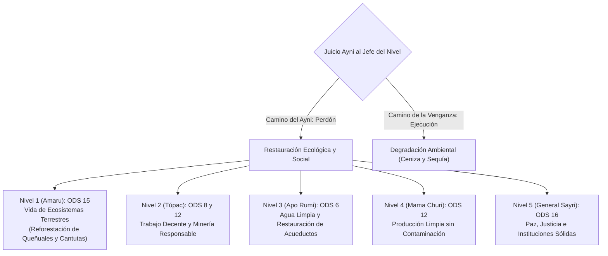

# 🏔️ FUNDAMENTACIÓN CULTURAL ANDINA, GLOSARIO QUECHUA Y ENFOQUE ODS
# 🌄 AYNI: EL RETORNO DEL GUARDIÁN (`v0.7.0`)

> **Documento de Investigación Cultural, Narrativa Histórica y Sostenibilidad Ambiental (Agenda 2030)**  
> **Ejes Temáticos:** Cosmovisión del Tawantinsuyu · Arte Marcial *Rumi Maki / Takanakuy* · Ingeniería del *Qhapaq Ñan* · Objetivos de Desarrollo Sostenible (ODS)

---

## 📌 1. FUNDAMENTACIÓN EN LA COSMOVISIÓN ANDINA

El diseño narrativo y mecánico de **AYNI: El Retorno del Guardián** traduce conceptos filosóficos, arquitectónicos y rituales de los Andes centrales en sistemas interactivos de juego:

### 1.1. El Principio del *Ayni* (Reciprocidad Cósmica)
En la organización social y espiritual andina, el **Ayni** constituye la ley de reciprocidad simétrica (*"Hoy por ti, mañana por mí"*). No se limita al intercambio de trabajo agrícola (*minka*) entre familias del *ayllu*, sino que rige la relación sagrada entre los seres humanos, la **Pachamama** (Madre Tierra) y los **Apus** (espíritus tutelares de las montañas).
- **Traducción mecánica:** Cuando un jefe usurpador rompe este equilibrio al depredar los bosques o acaparar el agua, el jugador no restaura el orden simplemente matándolo. En [`AyniPurificationManager.cs`](Assets/Scripts/Core/AyniPurificationManager.cs), la violencia letal (**Venganza**) perpetúa la destrucción (lluvia de cenizas), mientras que el **Perdón Ayni** desarma al agresor, lo obliga a restituir lo tomado, reduce el peso kármico del jugador (`DecreaseDeathCounter()`) y desencadena la regeneración ecológica del valle.

### 1.2. El Talismán Sagrado *Illa* y la Energía Vital (*Kamaq*)
Las **Illas** son amuletos líticos o metálicos tallados con formas sagradas que, según la tradición andina, condensan la fuerza vital o *Kamaq* otorgada por el rayo (*Illapa*) y el sol (*Inti*).
- **Traducción mecánica:** En [`IllaTalismanSystem.cs`](Assets/Scripts/Core/IllaTalismanSystem.cs), la Illa impide que **Yari** cruce definitivamente al *Uku Pacha* (mundo interior/subterráneo) al caer en batalla o al abismo. Sin embargo, fiel a la ley del Ayni, toda resurrección exige una reciprocidad biológica: Yari cede años de su juventud física a cambio de sabiduría y contundencia espiritual (*Juventud* ➔ *Madurez* ➔ *Maestro Anciano*).

### 1.3. El Arte Marcial Ancestral *Rumi Maki* y el *Takanakuy*
El sistema de combate se inspira en las tradiciones marciales prehispánicas (*Rumi Maki*, "Mano o Puño de Piedra") y en el **Takanakuy** ("golpearse mutuamente"), práctica ritual vigente en los Andes peruanos (particularmente en Chumbivilcas, Cusco) donde los contendientes resuelven conflictos a puño limpio en un círculo comunitario para cerrar rencores y empezar el nuevo ciclo en paz.
- **Traducción mecánica:** El componente [`AndeanCombatStanceModifier.cs`](Assets/Scripts/Combat/AndeanCombatStanceModifier.cs) modifica proceduralmente en cada fotograma el esqueleto de Yari para adoptar la postura característica del Takanakuy: centro de gravedad bajo (cadera `-12 cm`), torso ligeramente inclinado hacia adelante (`8°`), guardia alta protegiendo los pómulos y codos abiertos (`14°`), culminando cada duelo con el abrazo o perdón ritual del Ayni.

---

## 📖 2. GLOSARIO TERMINOLÓGICO QUECHUA–ESPAÑOL DEL PROYECTO

| Término Quechua / Andino | Significado Etimológico y Cultural | Aplicación en el Videojuego |
| :--- | :--- | :--- |
| **Ayni** | Reciprocidad mutua, correspondencia y equilibrio comunitario. | Sistema moral central (`AyniJudgment`, `AyniPurificationManager`). |
| **Yari** | Nombre propio inspirado en el coraje y la luz solar que despierta. | Protagonista y último Guardián del Sol controlado por el jugador. |
| **Amaru** | Serpiente mítica alada vinculada a los ríos, la selva alta y las fuerzas telúricas. | Jefe del Nivel 1 (*Amaru el Cazador*), líder de los furtivos del Antisuyo. |
| **Sayri** | Príncipe o caudillo militar. | Antagonista principal (*General Sayri el Usurpador*), responsable de la traición inicial. |
| **Illa** | Reliquia sagrada portadora de luz, fortuna y energía vital. | Talismán que resucita a Yari a cambio de envejecer (`IllaTalismanSystem`). |
| **Rumi Maki** | *Rumi* (piedra) + *Maki* (mano/puño): "Puño de Piedra". | Estilo de combate cuerpo a cuerpo de Yari (combos ligeros, pesados y desvíos). |
| **Takanakuy** | De *takay* (golpear) y *-nakuy* (mutuamente): duelo ritual comunitario. | Postura de guardia plantada y filosofía de resolución sin muerte del oponente. |
| **Qhapaq Ñan** | El Gran Camino Inca que integraba las cuatro regiones del Tawantinsuyu. | Calzada empedrada de 630 m que vertebra todo el recorrido del Nivel 1. |
| **Tawantinsuyu** | "Las cuatro regiones unidas" (*Chinchaysuyu, Antisuyu, Qullasuyu, Kuntisuyu*). | Mundo en el que transcurren las cinco misiones del juego. |
| **Antisuyu** | Región oriental de ceja de selva y bosques nubosos andinos. | Bioma del Nivel 1 (*Valle de las Sombras*), amenazado por la quema forestal. |
| **Kancha** | Recinto rectangular amurallado con estructuras dispuestas en torno a un patio central. | Las 4 arenas de combate (`K1` a `K4`) generadas por [`AyniVillageBuilder.cs`](Assets/Editor/AyniVillageBuilder.cs). |
| **Tambo (*Tampu*)** | Albergue y centro de acopio estatal situado a lo largo del Qhapaq Ñan. | Recinto `K3 · Tambo del Camino`, custodiado por los Guardias del Tambo. |
| **Chasqui (*Chaski*)** | Mensajero corredor del imperio que transmitía recados y *quipus* por relevos. | Arquetipo del primer rival (`Rival_1_Rastreador`) en `K1 · Puesto de Chasquis`. |
| **Pirca (*Pirqa*)** | Muro de piedra rústica asentada con mortero de arcilla. | Modo `0` del shader procedural [`AyniMuroInca.shader`](Assets/Shaders/AyniMuroInca.shader). |
| **Huanca (*Wanka*)** | Monolito vertical sagrado que marca el centro energético de un patio o chacra. | Hito de piedra presente en el patio del Puesto de Chasquis (`K1`). |
| **Champi** | Maza incaica de combate con cabezal estrellado de bronce o piedra. | Arma con la que el General Sayri quiebra la guardia de Yari en el prólogo. |
| **Queñual (*Qiwña* / *Polylepis*)** | Árbol altoandino de corteza rojiza laminar que crece hasta más de 4,500 m.s.n.m. | Especie principal generada por [`AyniReforestation.cs`](Assets/Scripts/Story/AyniReforestation.cs) al perdonar al jefe. |
| **Ichu** | Gramínea forrajera resistente al frío propia de la puna andina. | Pastizal que brota en el final Ayni y material de los techos de las kanchas. |
| **Cantuta (*Qantu*)** | Flor sagrada de los incas de cáliz tubular rojo, rosado y amarillo. | Flor que tapiza el claro reforestado en la cinemática del perdón. |
| **Intihuatana** | "Lugar donde se amarra el Sol"; observatorio astronómico y altar monolítico. | Escenario final de la Misión 5 a 5,000 m.s.n.m. |
| **Sumak Kawsay / Allin Kawsay** | "El Buen Vivir": plenitud de vida en armonía con la comunidad y la naturaleza. | Rango máximo otorgado al jugador que completa el viaje perdonando a los jefes. |

---

## 🌱 3. ALINEACIÓN CON LOS OBJETIVOS DE DESARROLLO SOSTENIBLE (ODS — AGENDA 2030)

El proyecto integra de forma orgánica la educación ambiental y ciudadana dentro de la resolución de cada nivel:

### Detalle Ecológico del Nivel 1: El Bosque de Queñuales (*Polylepis*) y el ODS 15
Los bosques de **Queñual (`Polylepis`)** se encuentran entre los ecosistemas forestales más altos del planeta y cumplen una función vital en los Andes: sus troncos retorcidos y el musgo asociado capturan la humedad de las nubes y regulan el caudal de agua hacia los valles inferiores, evitando aluviones y sequías. Históricamente, la tala y los incendios forestales han reducido drásticamente su cobertura.

En **AYNI: El Retorno del Guardián**, el camino hacia Amaru muestra las consecuencias de la quema forestal mediante **56 árboles carbonizados en pie y 5 troncos caídos** ([`AyniBurntTree.cs`](Assets/Scripts/World/AyniBurntTree.cs)). Cuando el jugador elige el perdón en el Juicio Ayni:
1. Comienza a llover sobre la plaza y una onda expansiva de vida brota desde el centro ([`AyniReforestation.cs`](Assets/Scripts/Story/AyniReforestation.cs)), generando plantones, queñuales adultos de corteza rojiza, matas de ichu y flores de cantuta.
2. Simultáneamente, [`AyniReforestationRevival.cs`](Assets/Scripts/Story/AyniReforestationRevival.cs) propaga la ola a lo largo de los 630 metros del camino, devolviendo el color de la madera viva y haciendo brotar copas verdes en cada uno de los 61 árboles quemados, cerrando con el mensaje de concienciación del **ODS 15: Vida de Ecosistemas Terrestres**.

---

## 🎙️ 4. GUION NARRATIVO Y EXPRESIONES EN QUECHUA PARA DIRECCIÓN DE VOCES

Para enriquecer la inmersión sonora en futuras iteraciones de doblaje, se definen las líneas y exclamaciones en Quechua (variedad Chanka/Cusqueño) con su traducción oficial para subtítulos:

| Personaje / Momento | Expresión en Quechua | Traducción en Subtítulo (Español) | Contexto de Uso |
| :--- | :--- | :--- | :--- |
| **General Sayri (Prólogo)** | *"¡Tukukunkiñam, Yari! ¡Intiqa ñuqapmi!"* | "¡Aquí terminas, Yari! ¡El Sol ahora me pertenece!" | En el puente colgante antes de quebrar la guardia de Yari con la Champi. |
| **Chamán / Voz de la Illa** | *"Hatariy, Intip Wawan... Aynita kutichiy."* | "Levántate, Hijo del Sol... Devuelve el equilibrio del Ayni." | Durante la caída al abismo cuando se enciende el Talismán Illa. |
| **Yari (Al resucitar)** | *"Manaraqmi tukukunichu... Pachamamapaq."* | "Aún no ha terminado... Por la Madre Tierra." | Al levantarse tras activarse `TriggerResurrection()`. |
| **Amaru (Inicio Fase 1)** | *"¡Sach'akunapas uywakunapas ñuqapmi!"* | "¡Los bosques y las bestias son mi presa!" | Al entrar Yari en la plaza principal del Cazador. |
| **Amaru (Transición Fase 2)** | *"¡Amaru hina phiñasqam hatarini!"* | "¡Me alzo con la furia de la serpiente sagrada!" | Durante la cinemática de `AyniBossPhaseDirector` junto al rugido `Gen_Roar`. |
| **Yari (Juicio: Perdón Ayni)** | *"Saqiy maqanakuyta. Sach'akunata kutichiy."* | "Deja las armas. Devuelve la vida a los bosques que quemaste." | Al presionar `X` / `A` en el Juicio Ayni. |
| **Yari (Juicio: Venganza)** | *"Uku Pachaman riy."* | "Desciende al inframundo." | Al presionar `F` / `B` en el camino de la Venganza. |

---
*Documento de Fundamentación Cultural y Narrativa — Proyecto Ayni: El Retorno del Guardián.*
